# POSS 场地抢位程序

在本地网页中选择多个账号、Activity、场馆和时段；到放位时间，各通道用独立会话并行尝试。
每个账号在每个目标日期、每种 Activity 抢到一笔即停止该 Activity；同一账号的其他 Activity 和其他账号继续抢。不同账号不会重复抢同日期、重叠时段的同一球场。

## Mac 本地部署

1. 安装 Python 3.12 或更新版本、Git，并在项目目录安装依赖：

   ```bash
   git clone git@github.com:Oxidaner/polyu-poss-booking.git
   cd polyu-poss-booking
   python3 -m venv .venv
   .venv/bin/python -m pip install -r requirements.txt
   .venv/bin/python poss_ui.py --no-browser
   ```

2. 在本机浏览器打开 `http://127.0.0.1:8765/`。服务只监听 `127.0.0.1`；终端按 `Ctrl+C` 停止 UI。首次使用在「账号与自动抢位」填写 NetID 和密码并保存，程序会验证登录、读取余额；密码写入本地 `.env`，不会由「一键上传 config.json」上传。
3. 选择 Facility、Activity、Center、Area，再**点击时间表中的时段**加入「并行抢位目标」。切换下拉框本身不会改变已有目标；要更换场地，先移除旧目标，再添加新场地的时段。确认列表中的日期、场馆和时间后点「保存目标」，写入本地 `config.json`。上传按钮也会先保存当前列表，再上传配置。
4. 需要 Mac 执行抢位时，点击「启动本地程序并等待放位」，或在另一个终端运行 `.venv/bin/python monitor.py --wait`。UI 服务和后台抢位进程相互独立；关闭网页不会停止抢位进程，Mac 需保持开机、联网。只用 Mac 管理 GitHub 配置时，运行 UI 即可，不要再启动本地抢位，以免与云端同时用相同账号抢同一目标。UI 中显示后台进程 PID；需要提前停止时，在终端执行 `kill -TERM <PID>`。

保存账号时，程序会用独立会话逐个登录 POSS，并读取各账号的 Deposit Balance。账号行显示可登录状态、余额和香港时间；余额读取失败会显示原因，不会当作 0。点击「验证账号并刷新余额」可手动重新读取；重启页面服务后，之前的验证结果需手动刷新。该检查只读取登录、预订和充值页面，不发送预订请求。

只选 Badminton 就只抢 Badminton，无须配置 Fitness。目标卡片的「抢位账号」可以选具体账号，指定后只有该账号会尝试该场地和时段；默认「自动分配」会优先把不同目标分给不同账号，未成功的账号仍可补抢其他自动分配目标。程序会避免两个账号抢同一日期、重叠时段的同一球场。各账号能否都抢到仍取决于候选场地数量和 POSS 的实际结果。

「任意 Area」会自动遍历该时段已预备的球场，不必逐一添加具体 Area。也可以只添加指定 Area；同一球场同时出现在两类目标中时，只会提交一次。

放位时刻由 `config.json` 的 `booking.lead_days`（默认提前 7 天）与 `booking.trigger_time`（默认香港时间 08:30）决定。例如抢 10 月 27 日的场地，提前 7 天就是 10 月 20 日 08:30 放位。程序不会把过期目标自动改到另一天；启动前请核对目标日期。`--dry-run` 只检查请求准备过程，不会下单。

`.env` 保存登录和通知凭据，不能提交到仓库；`config.json` 保存目标和放位设置。UI 的「真实下单测试」只针对手动选中的单笔目标，和自动并行抢位是两种独立操作。可以通过本地 `monitor.py` 或 GitHub Actions 运行自动抢位，避免两端同时抢同一组账号与目标。

## Windows 本地部署

Windows 版直接在这台电脑上管理账号、读取 POSS 和运行本地抢位程序。无需安装 Git、Node.js 或其他服务；除已安装的 **Python 3.14** 外，所需 Python 依赖由安装脚本自动准备。

### 安装与启动

1. 将**完整项目文件夹**放到固定位置，例如 `D:\poss-booking`。不要只复制 `.py` 文件；`config.json`、`ui.css` 和其余项目文件都要保留。
2. 双击项目根目录的 `install_windows.cmd`。脚本会检查 Python 3.14、创建独立的 `.venv` 并安装依赖。安装过程需要联网，结束前不要关闭窗口。
3. 安装完成后双击 `start_windows.cmd`。程序会启动本地管理页面并尝试打开浏览器；如未自动打开，请访问 `http://127.0.0.1:8765/`。启动窗口保持打开。

### 配置并抢位

1. 在「账号与自动抢位」添加账号及密码并保存。程序会逐个验证账号登录并读取余额；账号密码只保存到项目目录的 `.env`。
2. 在「选择课程」中选好 Activity 和 Center，读取官方时间表，再点击目标时段加入「并行抢位目标」。确认日期、场馆、Area 和时段无误后，点击「保存目标」。
3. 点击「启动本地程序并等待放位」。抢位程序会在后台运行；关闭浏览器页面不会停止它。放位前保持电脑开机、联网，并保持 `start_windows.cmd` 窗口打开。
4. 当前启动方式只使用本机的 `config.json` 和账号，不显示配置同步入口，也不会由 UI 上传配置。

### 停止与日志

- 停止管理页面：切换到 `start_windows.cmd` 窗口，按 `Ctrl+C`。
- 停止后台抢位程序：双击 `stop_windows.cmd`。仅关闭浏览器或管理页面不会结束后台程序。
- 抢位诊断日志位于 `dumps\booking_attempts.jsonl`；后台进程日志位于 `dumps\booking-local.log`。

### 常见问题

- **找不到 Python 3.14：**重新安装 Python 3.14，并在安装器中勾选 `Add python.exe to PATH`；再运行 `install_windows.cmd`。
- **安装依赖失败：**确认网络可访问 Python 包服务，然后重新运行 `install_windows.cmd`；它会复用已创建的 `.venv`。
- **网页无法打开：**确认启动窗口仍在运行，并访问 `http://127.0.0.1:8765/`。如果端口已被占用，关闭占用该端口的程序后重试。
- **连接 POSS 时提示无法连接代理：**如果代理软件已关闭，检查 Windows 环境变量是否还配置了失效的 `HTTP_PROXY`、`HTTPS_PROXY`、`ALL_PROXY` 或对应的小写变量。可在 PowerShell 用 `Get-ChildItem Env:*proxy*` 查看当前终端代理变量；仅当不需要代理时，再用 `Remove-Item Env:HTTP_PROXY,Env:HTTPS_PROXY,Env:ALL_PROXY,Env:http_proxy,Env:https_proxy,Env:all_proxy -ErrorAction SilentlyContinue` 清除当前 PowerShell 会话中的设置，然后从该窗口重新启动程序。
- **确认抢位结果：**先查看 `dumps\booking_attempts.jsonl` 中对应日期和目标的阶段、HTTP 状态与结果，再到 POSS 的 `My Record` 核实最终预约。

## GitHub Actions + Cloudflare 自动部署

**运行链路：**Cloudflare Worker 每天 **00:15 UTC / 香港 08:15** 调用 GitHub 的 `workflow_dispatch`；GitHub Actions 读取 `main` 上的 `config.json`，登录并等待香港 **08:30** 放位。Worker 只负责启动 Actions，不运行 Python 抢位程序；工作流本身没有 `schedule`。下面的图片来自实际页面（2026-10-23），只展示入口和配置名称，不包含密码或 Token 值。界面文案以后可能变化。

### 首次配置（按顺序）

1. **确认仓库和目标日期。**打开 GitHub 仓库的 `Code` 页面，确认分支为 `main`，可看到 `.github/workflows/monitor.yml`、`cloudflare/` 和 `config.json`。在本地 UI 选好**未来日期**的目标，保存并上传 `config.json`；先计算放位日：目标日期减去 `booking.lead_days`（默认 7 天）。如果放位日已经过去，云端不会替你补抢。

   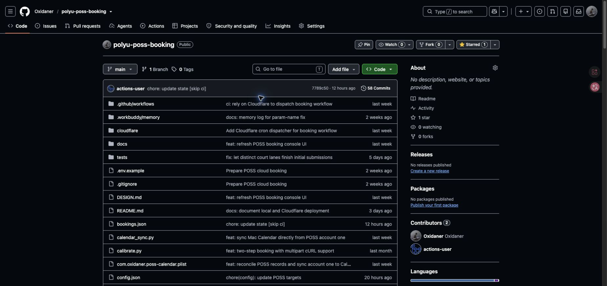

   **当前仓库显示为 Public**，且 `bookings.json` 会包含预约详情。建议先在仓库 `Settings → General → Danger Zone → Change repository visibility` 改为 Private；若要继续公开仓库，请先自行处理已有的公开预约信息。不要把 `.env`、密码或本地 `dumps/` 上传到仓库。云端运行会写回 `state.json` 和 `bookings.json`，不要用本地旧文件覆盖它们。

   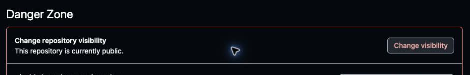

2. **设置 GitHub 上的 POSS 账号。**进入仓库 `Settings → Secrets and variables → Actions`，在 `Repository secrets` 点 `New repository secret`。当前工作流要求分别添加 `POSS_NETID`、`POSS_PASSWORD`、`POSS_NETID_2`、`POSS_PASSWORD_2`；名称必须完全一致。每个 Secret 单独添加：`Name` 填名称，`Secret` 填相应账号/密码，点 `Add secret`。之后列表只显示名称，不能读回值；改密码时编辑对应 Secret。

   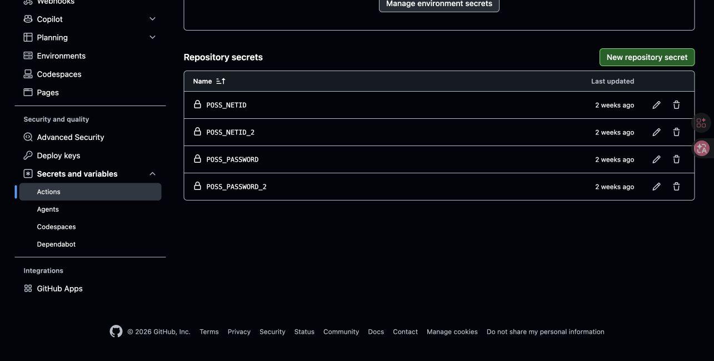

   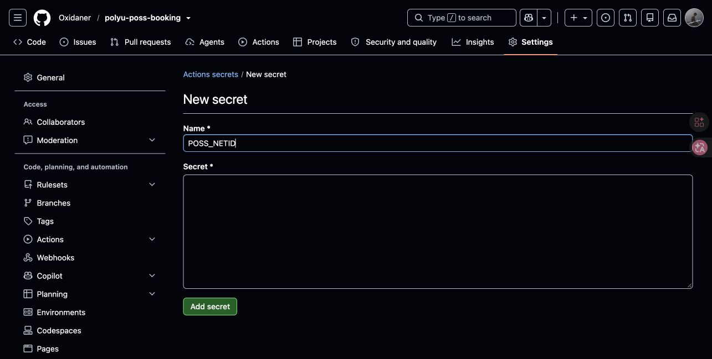

   通知可选：`PUSHPLUS_TOKEN`、`SERVERCHAN_KEY`、`SMTP_HOST`、`SMTP_USER`、`SMTP_PASS`、`MAIL_TO` 放在 Secrets，`SMTP_PORT` 放在 `Repository variables`。本地 UI 保存的 `.env` 不会自动同步到 GitHub。工作流自身已声明 `contents: write`，用运行时内置的 `GITHUB_TOKEN` 写回状态；这**不是**下一步发给 Cloudflare 的 Token。

3. **单独创建 Cloudflare 用的 GitHub Token。**在 GitHub 个人 `Settings → Developer settings → Personal access tokens → Fine-grained tokens → Generate new token`：选自己的账号为 `Resource owner`，设置可辨认的名称和到期时间；`Repository access` 选 `Only select repositories` 并选择 `polyu-poss-booking`；在 `Repository permissions` 将 `Actions` 设为 `Read and write`，然后生成并**只在创建时**保存 Token。GitHub 可能要求重新验证身份，因此此处没有实际账号的 Token 表单截图；按 [GitHub 创建 fine-grained token 的官方步骤](https://docs.github.com/en/authentication/keeping-your-account-and-data-secure/managing-your-personal-access-tokens#creating-a-fine-grained-personal-access-token) 操作即可。不要把 Token 发到聊天、写入 README、提交到仓库，或误填进 GitHub 的 POSS Secrets。这个 Token 仅用于 Worker 调用 GitHub 的 [workflow dispatch API](https://docs.github.com/en/rest/actions/workflows#create-a-workflow-dispatch-event)。

4. **首次初始化 Cloudflare Workers。**登录 Cloudflare，进入 `Workers & Pages`，首次打开时按页面提示创建 `workers.dev` 子域（后面仍不会给本 Worker 开通公开 HTTP 地址）。如果部署报 `10063` / `You need a workers.dev subdomain`，先完成这一步，再重新部署；已上传代码不等于 Cron 已配置成功。

   

5. **在 Mac 上部署 Worker 和定时规则。**需要 Node.js/npm；在本项目根目录运行以下命令。`login` 会引导浏览器授权，`deploy` 使用仓库的 `cloudflare/worker.mjs` 和 `cloudflare/wrangler.jsonc`，部署名为 `poss-booking-dispatcher` 的 Worker。

   ```bash
   npx --yes wrangler@4.151.0 login
   npx --yes wrangler@4.151.0 deploy --config cloudflare/wrangler.jsonc
   ```

   部署后在 `Workers & Pages` 能看到 `poss-booking-dispatcher`（见上图）。配置中只有 `scheduled()` 处理器，`workers_dev: false`，不提供公开 HTTP 路由。不要只在 Cloudflare 网页新建一个不同名字的 Worker；本教程部署的是仓库中现成的 Worker。

6. **给 Worker 配置 GitHub Token。**在同一个项目根目录运行：

   ```bash
   npx --yes wrangler@4.151.0 secret put GITHUB_DISPATCH_TOKEN --config cloudflare/wrangler.jsonc
   ```

   根据终端提示输入第 3 步生成的 Token；输入不会写入源码。也可在 Cloudflare `poss-booking-dispatcher → Settings → Variables and Secrets → Add variable` 中选择**生产**、类型**密钥/Secret**、名称 `GITHUB_DISPATCH_TOKEN`，填入 Token 后保存部署。二选一即可，不需重复设置。

   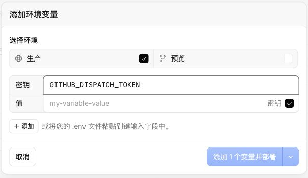

   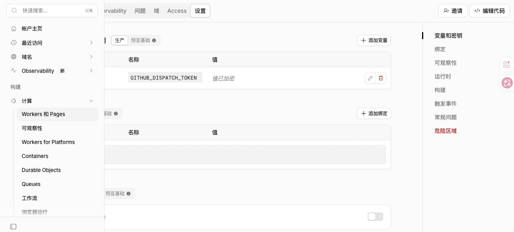

7. **核对 Cron 和日志开关。**打开该 Worker 的 `Settings → Triggers/触发事件`，确认只有一个 Cron：`15 0 * * *`，即每天 **00:15 UTC / 香港 08:15**。Cloudflare 新增或修改 Cron 后可能需最多约 15 分钟传播；因此应在放位日前部署并验证。Cron 由 `wrangler.jsonc` 管理，修改时间时改文件再重新 `deploy`，不要在网页另加一个重复的触发器。

   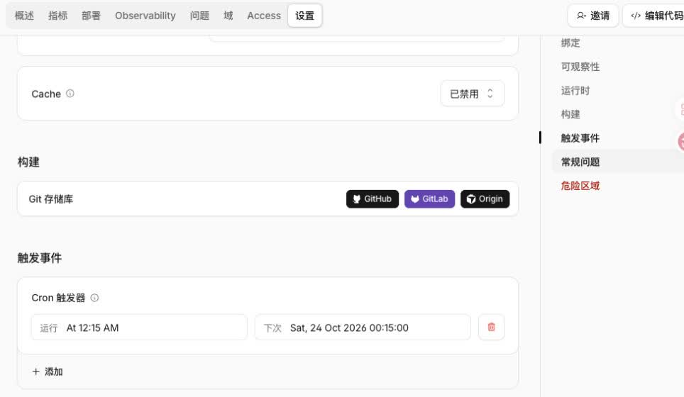

   当前 Worker 的 `Settings → Observability` 中 **Workers 日志处于关闭状态**。需要在 Cloudflare 查看 `GitHub workflow dispatch accepted` 或 HTTP 错误时，可自行启用日志；未开启时先以 GitHub Actions 的运行记录核对是否触发，不要以“Cloudflare 看不到日志”直接断定没有执行。

   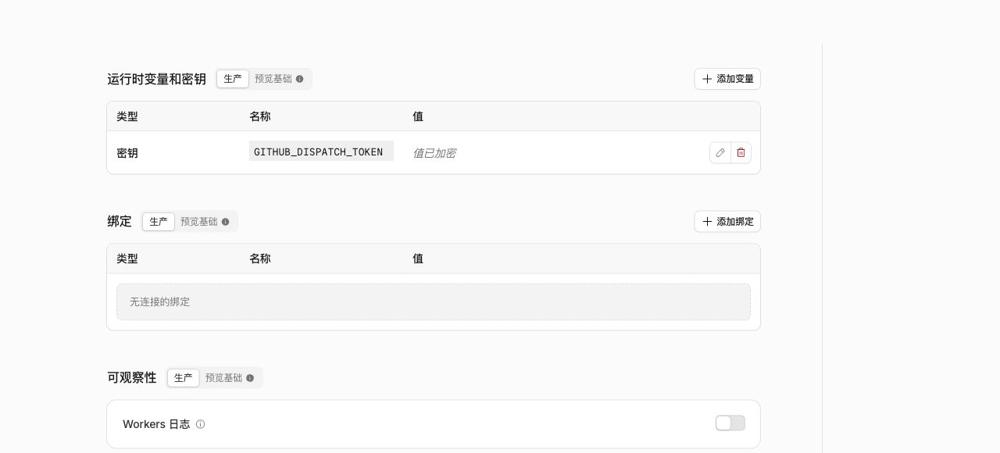

8. **检查 GitHub 是否启动。**进入仓库 `Actions → POSS Booking Backup`，在放位日约香港 08:15 应出现新运行。页面的 `Manually run by <账号>` 是 `workflow_dispatch` 事件的显示方式；由 Cloudflare API 触发时也可能这样显示，**不代表有人手动点击**。`Run workflow` 按钮可用于排查触发链路，但工作流运行 `monitor.py --wait --today-only`：如果当天不是目标的放位日，程序会正常结束，不会试下单。

   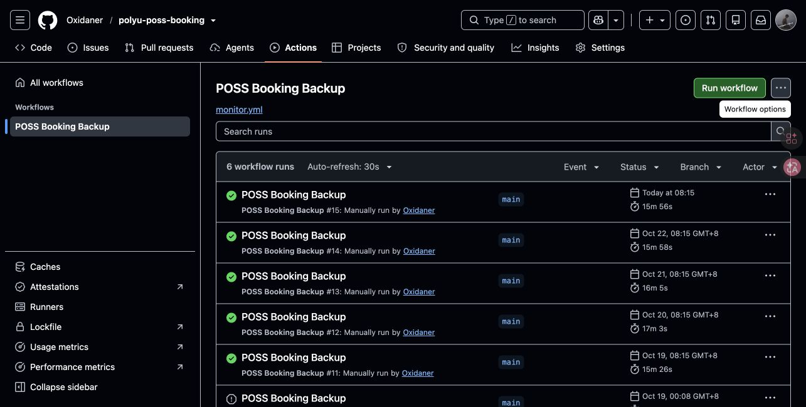

9. **区分运行完成与抢位成功。**点开本次运行：先看 `Summary` 的启动时间，再进入 `monitor`，展开 `Wait for release and book` 检查预热、放位时间和每个目标的结果。绿色 `Success` 只表示工作流执行完成，不等于预约成功；若启动太晚，日志会出现 `missed_release_window`。`Refresh confirmed bookings from POSS` 会复查账号的 `My Record`，`Commit state` 会提交云端状态。

   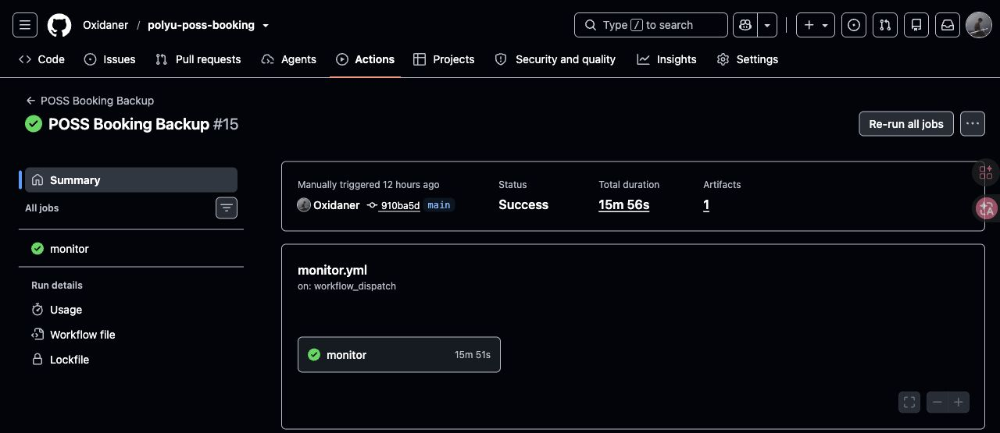

   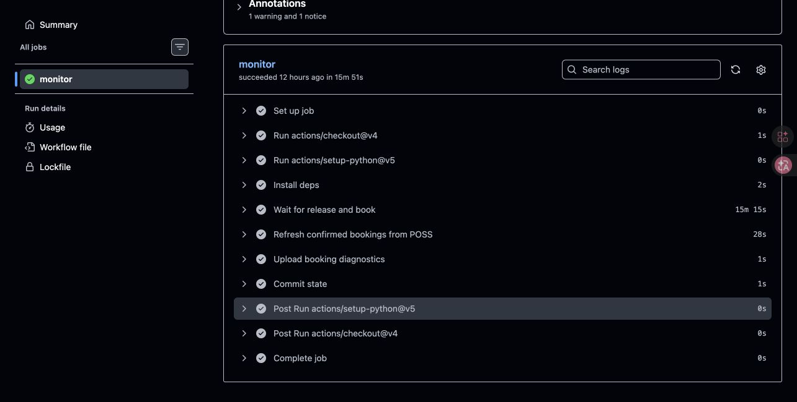

10. **下载失败原因。**在该运行的 `Summary` 底部找到 `Artifacts → poss-dumps` 下载（工作流保存 14 天），解压查看 `booking_attempts.jsonl`，逐球场确认有没有发出第一步请求、最终提交，以及 HTTP 状态、耗时和失败阶段。最终是否约上以 POSS `My Record` 的记录为准。

    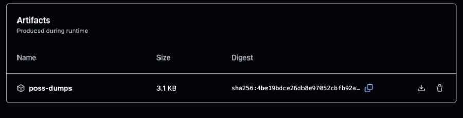

### 后续只改日期或场地

在本地 UI 移除旧目标、点击新日期的时间表时段加入目标，确认目标列表无误后点「一键上传 config.json」。它只上传配置，不会重新部署 Worker，也不会立即启动一次抢位；**下次 Cloudflare Cron** 会触发 Actions 读取 `main` 的最新配置。若提示与远端相同，先核对是否真的增删了目标，而不只是改了上方筛选下拉框。首次部署之外，只有修改 `cloudflare/worker.mjs` 或 `cloudflare/wrangler.jsonc` 才需要重新执行 `wrangler deploy`；修改 Python/工作流需正常提交推送到 GitHub，不需要重部署 Worker。

## 放位时的流程

1. 提前登录并保持会话；距离放位约 3 分钟和约 1 分钟时刷新连接。预热 TLS/网络错误按 30 秒重试，不退出等待进程。
2. 放位前从 POSS 时间表收集目标时段的球场编号，核对编号属于所选场馆；即使当时显示不可订也可预备。预检结果在 UI 中逐目标显示，编号按日期、场馆、时段写入 `state.json`。若随后时间表请求失败且缓存仍有效，可继续使用缓存。
3. 预检发现某目标的球场后，按球场数和可用账号数分配请求通道，每块球场对应一条通道；例如 7 块球场、2 个可用账号分为 4 条和 3 条。同一目标指定了账号时只在该账号内分配，指定了具体 Area 时只有一条通道。尚无缓存时先启动各账号的预检通道，再按实时预检结果补足通道；已预备编号可直接发送第一步请求，避免到点再等时间表。第一步读取超时为 45 秒；慢响应不会提前判失败。
4. 同一球场的最终提交不会重复发送；不同球场的首轮请求与最终提交可由同账号并行发送，POSS 判定账号的预约上限。缓存编号失效或与别的通道冲突时尝试换球场。每个账号的同一日期、同一 Activity 确认成功后，已分配给其他球场的首轮仍可完成，后续重试停止。其他 Activity 和账号继续。每块场地的状态分别保存，重启后跳过已成功或待确认的 Activity。
5. 最终提交超时或部分结果待确认时，只读查询 `My Record` 核对具体 Area；最终提交超时仍标记待核对。收到 `unknown_result` 时立即按该球场失败继续其他目标；日志明确标记本次核查已跳过。确认成功的其他 Activity 可继续。

时间表的临时网络故障可在放位窗口内重查，连续失败时逐渐放慢并加入随机延迟；遇到 `Retry-After` 时遵从服务器的等待要求。第一步请求若已经发出但响应丢失，程序把该通道标为未知，不盲目重发。
最终提交收到无法识别的结果页时，立即把这块球场记为失败并继续同账号其他目标，但不重复提交同一球场。随后可在 POSS `My Record` 核对是否实际成功；云端任务结束时会独立刷新预约记录。最终提交的网络超时仍保持待确认状态。

## 看结果与排障

- `dumps/booking_attempts.jsonl`：逐球场实时记录请求是否开始、阶段、HTTP 状态和耗时、缓存来源及可识别错误。第一步发出前会单独写入 `sending / first_step` 事件；成功或结果不明后立即写入结果，不等其他通道结束。
- `dumps/booking-local.log`：从网页启动的本地进程日志；网页也显示是否仍在运行。
- `state.json`：保存逐账号、逐目标预检状态、已预备球场编号、确认成功和最终提交待确认状态。若进程在最终提交后中断，UI 会标记该账号的该 Activity 待核对；重启不会自动重复提交。不保存密码或会话 Cookie。

UI 每约 3 秒刷新一次逐目标的预检状态、已确认/待确认球场数、失败阶段及请求耗时。统计来自本次运行的结构化日志；若程序尚未启动或放位日已过，会分别显示待启动或放位已过。

`no_vacancy` 表示查询时无可订球场，不足以单独证明被抢先；`read_timeout` 表示响应等待超时；`slot_taken` 表示 POSS 明确拒绝某块球场；`unknown` 表示请求可能已被处理，需到 POSS 的 `My Record` 核查。日志不会写入密码、Cookie、CSRF 或完整结果页。
HTTP 拒绝或结果不明时，可在对应事件中查看 `response_hint`（固定词匹配，涵盖预约上限与余额不足；`unclassified` 表示无法识别）、`confirmation_form`、`content_type`、`body_bytes`、`body_sha256` 和 `redirect_target`；跳转后的结果页另记 `result_page`。相同页面指纹有助于比较多账号是否遇到同一种响应，但不能单凭指纹断定拒绝原因。日志不记录响应原文、完整 URL 或跳转参数。

## Apple 日历同步

在 Mac「日历」中建立一个名为「POSS 预约」的 **iCloud** 日历，并在 iPhone 上启用同一 Apple 账户的 iCloud 日历。GitHub Action 每天抢位步骤结束后分别登录各账号，分页读取 POSS `My Record`，将当前有效的未来预约写入仓库的 `bookings.json`（包含账号、场馆、球场、日期、时段和核实时间）。取消与转让的旧预约不计入有效列表；账号读取失败时保留上次记录并标记错误，不用不完整结果覆盖。Action 失败的原因可在运行日志查看，列表中不会写入密码或 Cookie。

`calendar_sync.py` 每天 09:00（当前 Mac 时区为香港同区时间）用本机 `.env` 中**账号 1**的凭据直接登录 POSS、核实 `My Record`，再同步到专用日历；不读取 GitHub 的 `bookings.json`，账号 2 不进入日历。网络或会话异常会重试，未能完整核实时不更改日历。脚本会复用已有预约事件，删除已取消、已转让以及先前误同步的账号 2 未来事件；过去的事件保留。先运行 `.venv/bin/python calendar_sync.py --dry-run` 预览，再运行 `.venv/bin/python calendar_sync.py` 写入。macOS 首次操作日历可能要求允许自动化访问。后台任务配置见 `com.oxidaner.poss-calendar.plist`；其中的绝对路径属于原 Mac，换目录或另一台 Mac 使用前需改为实际路径。日志位于 `dumps/calendar-sync.log`。Mac 需保持开机、联网并登录用户账户。GitHub Action 继续单独维护各账号的 `bookings.json`，但不会影响本机日历。

回归测试：`.venv/bin/python -m unittest discover -s tests -q`。
